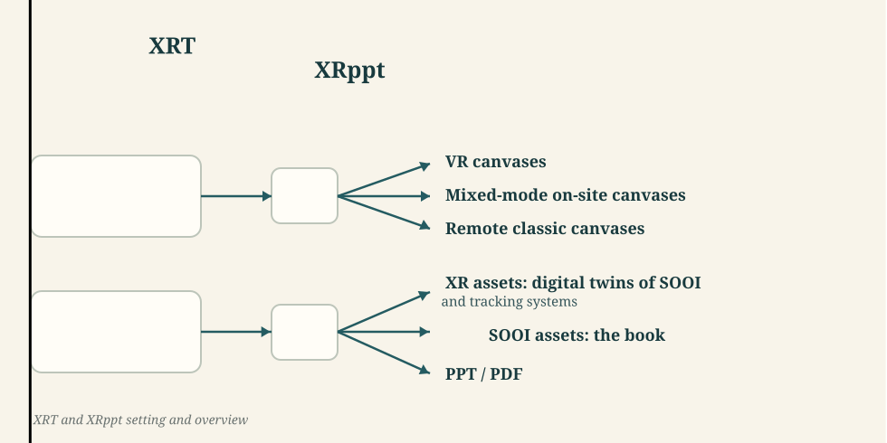
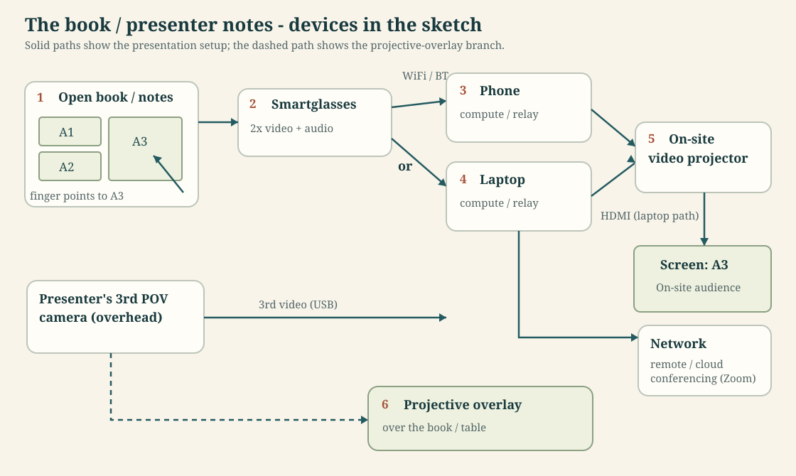
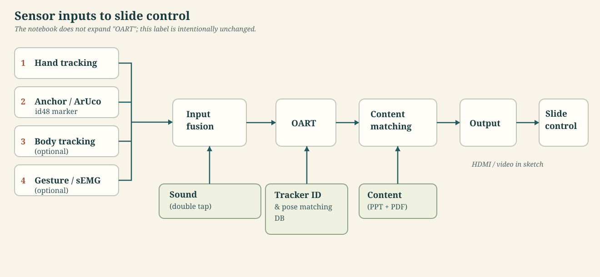
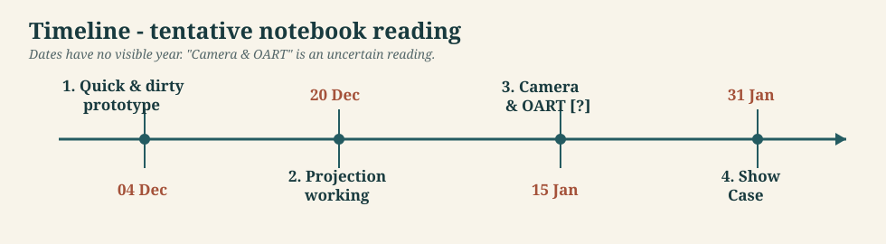

# XRT / XRPPT

**XRT** ("eXtended Reality Thesis") and **XRPPT** ("XR presentations"). XRT augments a physical book with projected content; XRPPT uses printed presenter notes to control a prepared presentation.

## 1. Overview

### Devices and audience

### Processing sketch

Four numbered inputs converge on `Input fusion`:

1. `hand tracking`
2. `anchor / aruco tracking`
3. `body tracking (optional)`
4. `gesture including sEMG tracking (optional)`

### Challenges

1. `Midas Touch`
2. `TIP DB growth and management` 
3. `Meta glass integration` 
4. `fallback GD scenario` 
5. `Content governance`

### The timeline

## 2. Concept

The same physical interaction model can serve two distinct scenarios:

| | XRT: augmented book | XRPPT: presentation control |
| --- | --- | --- |
| Physical target | Open book and nearby tabletop | Printed slide thumbnails and presenter notes |
| Camera | Overhead camera in the first prototype; glasses later | Smart-glasses camera(s), relayed by a phone or laptop |
| Compute | Heavier, local processing is acceptable | Prefer a lightweight, low-latency pipeline |
| Output | Projected dots, outlines, strokes, diagrams, or 3D content on the book/table | Keypress-like commands to advance or select prepared PPT/PDF slides on a room screen/projector |

For **XRT**, start with the existing top-down camera/projector rig. Because camera and projector are fixed together, the camera-to-projector homography can place visual overlays in the correct position on the book or adjacent table. A first interaction might be a red dot following the pointing finger; richer overlays could connect real sketches to projected diagrams or models.

For **XRPPT**, glasses provide video (and sound for a possible double-tap signal) to a phone or laptop. The compute device determines which printed page/region is in view, detects the pointing finger, decides whether an intentional selection occurred, and maps the selected region to a prepared slide command. An app to retransmit a given glasses' feed may be needed; compatibility with any particular model is not assumed.

### Recognition and interaction options

- **Page and region identity:** start with ArUco markers attached to pages if useful, but aim to register scanned/photographed pages and their regions of interest (ROIs). A hierarchical database and lightweight visual detectors (for example, small YOLO-style models) are a proposed direction.
- **Pointing and intent:** MediaPipe hand tracking is an initial finger/point detector. A double tap on the ROI, detected acoustically and/or from hand motion, can confirm selection rather than treating every pointed-at region as a command.
- **Midas-touch guard:** separate a cheap idle-versus-active discriminator from more specialized page, gesture, and intent detectors; only invoke the latter when appropriate. Normal gesticulation must not trigger slide changes. Dynamic gestures and an optional myoband/sEMG channel are future extensions.
- **Control mapping:** bind recognized page/ROI IDs to slide actions, then emit presentation keypresses. Keep recognition, intent confirmation, and slide control separate so an uncertain detection cannot directly fire an action.

The two flows share concepts (page/ROI identification, hand intent, content mapping) but have different outputs: **XRT adds projective XR to the physical surface; XRPPT drives an ordinary presentation.**
